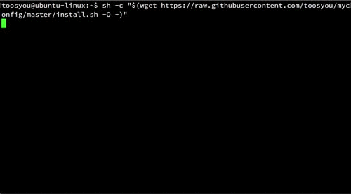

# myconfig
Use `curl` or `wget` to install packages and configures!  
Linux only (Ubuntu/Debian, via `apt-get`).  
  
**NOTE: myconfig will OVERWRITE your `oh-my-zsh`, `vim` and `tmux` configures!**
  
The installer asks whether to set up packages, zsh, vim, and tmux
individually (default: yes to all). To automate it (e.g. in CI or Docker),
set the corresponding env var before running the script and its prompt is
skipped: `MYCONFIG_SUDOER`, `MYCONFIG_INSTALL_PACKAGES`,
`MYCONFIG_INSTALL_ZSH`, `MYCONFIG_INSTALL_VIM`, `MYCONFIG_INSTALL_TMUX`
(`1` or `0`). See [Testing](#testing) for the Docker-based test harness.
  
**via curl**
```shell
bash -c "$(curl -fsSL https://raw.githubusercontent.com/toosyou/myconfig/master/install.sh)"
```
  
**via wget**  
```shell
bash -c "$(wget https://raw.githubusercontent.com/toosyou/myconfig/master/install.sh -O -)"
```

## Snapshots
### Ubuntu 14.04 LTS
  
- Only **one** password is needed to sudo `apt-get` and `chsh`.  
- Whole installation lasts about **one** minute, and you're ready to roll!  

# Installed packages
- zsh  
    - [oh-my-zsh](https://github.com/robbyrussell/oh-my-zsh)  
    - [bullet-train.zsh](https://github.com/caiogondim/bullet-train.zsh)  
      - Which needs powerline compatible fonts like [Vim Powerline patched fonts](https://github.com/Lokaltog/powerline-fonts), [Input Mono](http://input.fontbureau.com/) or [Monoid](http://larsenwork.com/monoid/).  
    - [zsh-autosuggestions](https://github.com/zsh-users/zsh-autosuggestions)  
    - [zsh-syntax-highlighting](https://github.com/zsh-users/zsh-syntax-highlighting)  
    - some **aliases** with commands that I always type wrong.  
- [mosh](https://mosh.org/)
- vim  
    - [Vundle](https://github.com/VundleVim/Vundle.vim)  
    - [The ultimate Vim configuration: vimrc](https://github.com/amix/vimrc)  
    - [delimitMate](https://github.com/Raimondi/delimitMate)  
- tmux  
    - mouse support  
    - [Tmux Plugin Manager](https://github.com/tmux-plugins/tpm) (tmux >= 2.3)  
    - [tmux-sensible](https://github.com/tmux-plugins/tmux-sensible) (tmux >= 2.3)  
    - [tmux-resurrect](https://github.com/tmux-plugins/tmux-resurrect) (tmux >= 2.3)  
    - [tmux-yank](https://github.com/tmux-plugins/tmux-yank) (tmux >= 2.3)  
    - [tmux-continuum](https://github.com/tmux-plugins/tmux-continuum)(tmux >= 2.3)  
- git
- wget
- python3
- pip3

# Testing

`Dockerfile` and `test.sh` run the installer end-to-end in a disposable
Ubuntu container (as a non-root, `sudo`-capable user, exercising the same
path a real laptop install takes) and assert that zsh became the login
shell, `~/.tmux.conf`/`~/.vimrc` are wired up, and the Vundle/oh-my-zsh
plugin directories are populated. Run it locally after changing
`install.sh`:

```shell
./test.sh
```

# Contact me
- email: toosyou.tw@gmail.com
